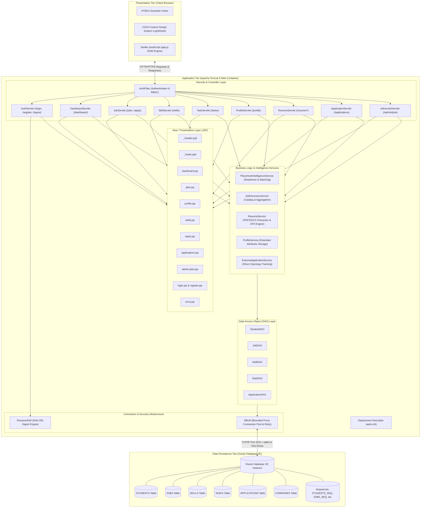
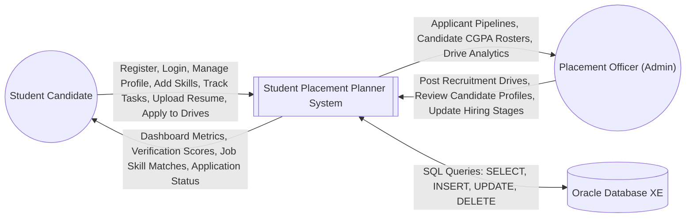
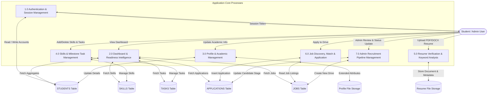
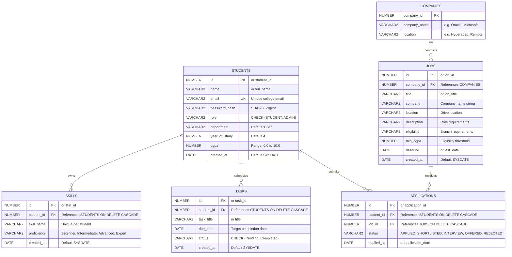

# CODE IMPLEMENTATION DOCUMENT

---

## 1. Cover Page

```
========================================================================================
                      LAKIREDDY BALI REDDY COLLEGE OF ENGINEERING
                                      (AUTONOMOUS)
   Approved by AICTE, New Delhi & Affiliated to JNTUK, Kakinada | Accredited by NAAC & NBA
                                 Mylavaram - 521230, Andhra Pradesh
========================================================================================

                 DEPARTMENT OF COMPUTER SCIENCE AND ENGINEERING
               FULL STACK DEVELOPMENT (FSD) LAB PROJECT DOCUMENTATION

----------------------------------------------------------------------------------------
                                PROJECT TITLE:
                          STUDENT PLACEMENT PLANNER
               A Robust Campus Career Readiness & Recruitment Portal
----------------------------------------------------------------------------------------

STUDENT DETAILS:
- Student Name        : V. Vijay Kumar
- Roll Number         : 24761A0559
- Department          : Computer Science and Engineering (CSE)
- Academic Batch      : 2024 – 2028
- Project Type        : Full Stack Development (FSD) Web Application

FACULTY GUIDE:
- Project Guide       : Dr. K. DeviPriya
- Designation         : Associate Professor / Faculty Mentor
- Department          : Computer Science and Engineering

ACADEMIC YEAR: 2025–2026
========================================================================================
```

---

## 2. Introduction and Project Overview

The transition of undergraduate engineering students from academic coursework to professional corporate careers is one of the most critical phases in higher education. However, students frequently encounter severe challenges in managing their campus recruitment preparations:

1. **Information Asymmetry**: Job openings, campus placement drives, and off-campus recruitment notices are distributed across disjointed messaging channels, physical notice boards, and email circulars.
2. **Unstructured Skill Preparation**: Students lack visibility into whether their current technical skillset matches the requirements of Tier-1 product, dream, and core engineering recruiters.
3. **Absence of Centralized Milestone Tracking**: Preparation for technical interviews requires disciplined milestone tracking (e.g., Data Structures and Algorithms practice, Database and SQL query preparation, Core Java project development, mock interviews). Without centralized task management, students often fall behind schedule.
4. **Lack of Resume Pre-Screening**: High volumes of applicants are eliminated at the initial resume screening stage due to formatting errors, missing key competencies, and lack of ATS (Applicant Tracking System) compliance.

The **Student Placement Planner** is an enterprise-grade, full-stack Java web application designed to solve these challenges. Developed strictly within the classical Java Enterprise ecosystem (**Java 17/21, Java Servlets 4.0, JavaServer Pages (JSP), Java Database Connectivity (JDBC), Oracle Database Express Edition (XE), and Apache Tomcat 9**), the system provides an end-to-end command center for students and placement officers.

### Key Capabilities
- **Role-Based Authentication**: Secure student registration and administrative access control with SHA-256 cryptographic password hashing and session fixation defense.
- **Dynamic Placement Dashboard**: High-level KPIs tracking available jobs, active job applications, tracked technical competencies, interview milestones, and an interactive placement readiness progress bar.
- **Student Profile & Academic Record Management**: Tracking of department, year of study, CGPA, contact details, LinkedIn/GitHub profiles, and automated drive eligibility tier computation.
- **Technical Skills Portfolio**: Student-curated skills matrix with proficiency ratings (Beginner, Intermediate, Advanced, Expert) and automated skill extraction from uploaded resumes.
- **Milestone & Task Planner**: Interactive preparation task scheduler with calendar due dates, overdue badges, inline editing, and live status toggling.
- **Integrated Resume Intelligence Engine**: Built-in resume verification pipeline parsing PDF, DOCX, and text resumes using pure Java libraries to evaluate structural completeness, calculate ATS readiness scores, and extract technical keywords.
- **Job Matching & Opportunities Portal**: Curated software engineering openings categorized across 12 modern technology roles, featuring dynamic client-side filtering, minimum CGPA eligibility enforcement, single-query application tracking, and an automated skill match algorithm.
- **Administrator Recruitment Portal**: Dedicated console for placement officers to post recruitment drives, review student submissions across departments, inspect candidate profiles, and advance candidates through recruitment review stages.
- **Enterprise-Grade Database Resilience**: Built-in bounded dynamic proxy connection pool and automatic exponential backoff retry handler to manage Oracle Database connection and process limits.

---

## 3. Problem Statement and Objectives

### 3.1 Problem Statement
Campus placement departments and engineering students face significant administrative and technical friction during recruitment seasons. Existing placement workflows rely heavily on static spreadsheets and manual email distributions, causing:
- Missed recruitment deadlines due to lack of real-time application tracking.
- Mismatched student preparations where candidates focus on outdated or irrelevant technologies.
- Application bottlenecks and database connection saturation during recruitment drives.
- High rejection rates during resume screening due to poor structural formatting and missing keywords.

### 3.2 Project Objectives
1. **Develop a Multi-Tiered Web Architecture**: Create a 3-tier Java web application separating client-side presentation, server-side controller/business logic, and relational persistence.
2. **Implement Secure User Authentication & Authorization**: Provide registration, login, and role-based access control (`STUDENT` vs. `ADMIN`) with protection against session hijacking, session fixation, and brute-force tampering.
3. **Deliver a Centralized Preparation Command Center**: Offer real-time student tracking of technical milestones, skill acquisition, and drive applications.
4. **Build an ATS Resume Verification Engine**: Implement text extraction and automated scoring algorithms to evaluate resume quality without external third-party dependencies.
5. **Optimize Database Persistence**: Design a normalized Oracle Database XE schema supported by sequence-based primary keys, foreign key cascading constraints, connection pooling, and optimized SQL queries to avoid N+1 query bottlenecks.
6. **Ensure Reliability on Constrained Database Environments**: Prevent transient listener failures (`ORA-12516`, `ORA-12519`) common in lightweight Oracle XE instances through connection pooling and retry handlers.

---

## 4. Hardware and Software Requirements

### 4.1 Hardware Requirements
| Component | Minimum Specification | Recommended Specification |
| :--- | :--- | :--- |
| **Processor** | Dual-Core Intel Core i3 / AMD Ryzen 3 (2.0 GHz) | Quad-Core Intel Core i5 / AMD Ryzen 5 or higher (2.5 GHz+) |
| **RAM** | 4.0 GB | 8.0 GB – 16.0 GB |
| **Hard Disk Storage**| 2.0 GB free disk space | 10.0 GB free SSD storage |
| **Display Resolution**| 1280 x 720 (HD) | 1920 x 1080 (Full HD) |
| **Network Interface** | Standard 10/100 Mbps NIC (for local loopback) | Gigabit Ethernet / Wi-Fi |

### 4.2 Software Requirements
| Category | Tool / Software | Version | Purpose |
| :--- | :--- | :--- | :--- |
| **Operating System** | Microsoft Windows | Windows 10 / Windows 11 (64-bit) | Host Development and Execution OS |
| **Java Development Kit**| Oracle JDK / OpenJDK | JDK 17 LTS / JDK 21 LTS | Java Compiler and Runtime Environment |
| **Web Server / Servlet Engine**| Apache Tomcat | Version 9.0.x (e.g., 9.0.120) | Java Servlet 4.0 and JSP 2.3 Container |
| **Relational Database** | Oracle Database XE | 10g XE / 19c / 21c / 23c XE | Relational Persistence & Integrity Storage |
| **Database Driver** | Oracle JDBC Thin Driver | `ojdbc11-23.6.0.24.10.jar` | JDBC Type-4 Network Protocol Connectivity |
| **Integrated Development Environment**| Eclipse IDE | Enterprise Java and Web Developers (2023/2024) | Source Editing, Server Management, Deployment |
| **Build Management** | Apache Maven | 3.8.x / 3.9.x | Dependency Management and WAR Packaging |
| **Web Browser** | Google Chrome / Mozilla Firefox / MS Edge | Modern Evergreen Versions | Client-side Rendering, DOM Manipulation, CSS Inspection |

---

## 5. Technologies Used and Their Roles

```
+-------------------------------------------------------------------------------+
|                             TECHNOLOGY MATRIX                                 |
+-------------------+---------------------------+-------------------------------+
| Layer             | Technology / Library      | Specific Role in Project      |
+-------------------+---------------------------+-------------------------------+
| Frontend (UI/UX)  | HTML5                     | Semantic structure of pages   |
|                   | CSS3 (Design System)      | Responsive layout, tokens     |
|                   | JavaScript (ES6+)         | DOM manipulation, validation  |
|                   | Google Fonts (Plus Jakarta)| Clean typography             |
+-------------------+---------------------------+-------------------------------+
| Controller / Web  | Java Servlets (Javax 4.0) | HTTP request handling, routes |
|                   | Java Web Filters          | Session & role authorization  |
|                   | MultipartConfig           | Binary resume file uploads    |
+-------------------+---------------------------+-------------------------------+
| View / Rendering  | JavaServer Pages (JSP 2.3)| Server-side dynamic rendering |
|                   | JSP Fragment Files (.jspf)| Reusable headers and footers  |
|                   | JSTL / Java Scriptlets    | Conditional presentation logic|
+-------------------+---------------------------+-------------------------------+
| Service / Domain  | Java 17 Core Libraries    | Business intelligence logic   |
|                   | Java Reflection / Proxies | Connection pool wrapping      |
|                   | Java Security / HexFormat | SHA-256 cryptographic hashing |
+-------------------+---------------------------+-------------------------------+
| Data Persistence  | Java Database Connectivity| Relational DB operations      |
|                   | Oracle Thin Driver        | Type-4 client socket protocol |
|                   | Oracle Database XE        | Relational tables & sequences |
+-------------------+---------------------------+-------------------------------+
| Application Server| Apache Tomcat 9           | Thread pooling & lifecycle    |
| IDE               | Eclipse IDE for Enterprise| WTP runtime & deployment      |
+-------------------+---------------------------+-------------------------------+
```

### Detailed Breakdown of Roles
1. **HTML5**: Delivers accessible, semantic page layouts using `<header>`, `<main>`, `<section>`, `<nav>`, `<footer>`, `<form>`, `<input>`, and `<dialog>` tags.
2. **CSS3**: Implements a cohesive design system using CSS Custom Properties (`--bg-primary`, `--primary`, `--surface-card`, etc.), CSS Flexbox, CSS Grid, media queries for mobile-responsiveness, and smooth CSS keyframe transitions. Supports both Light and Dark color themes with zero-flash pre-rendering.
3. **JavaScript (ES6+)**: Handles instant client-side searching and filtering of job listings, dynamic tag insertion, form validation (confirming password lengths and matching values), theme switching with `localStorage` persistence, and modal confirmation dialogs.
4. **Java Servlets (`javax.servlet.http.HttpServlet`)**: Serves as the Controller layer in the MVC pattern. Intercepts HTTP `GET` and `POST` requests, validates incoming parameters, coordinates business service invocations, interfaces with Data Access Objects (DAOs), and forwards execution to JSP views.
5. **Java Web Filters (`javax.servlet.Filter`)**: Implements declarative authentication and authorization via `AuthFilter`. Blocks unauthenticated access to secure endpoints (`/dashboard`, `/profile`, `/skills`, `/tasks`, `/applications`, `/resume`) and enforces strict role separation for `/admin/*`.
6. **JavaServer Pages (JSP)**: Represents the View layer. Evaluates server-side request attributes and renders dynamic HTML while utilizing modular JSP fragments (`_header.jspf` and `_footer.jspf`) for site-wide consistency.
7. **Java Database Connectivity (JDBC)**: Connects the Java application layer to the Oracle Database. Uses `PreparedStatement` with parameterized placeholders (`?`) to prevent SQL injection vulnerabilities and manage transactional integrity.
8. **Oracle Database XE**: Serves as the relational database engine. Enforces referential integrity using primary keys, unique constraints, foreign keys with `ON DELETE CASCADE`, and database sequences.
9. **Apache Tomcat 9**: Provides the standard Java Servlet 4.0 and JSP 2.3 runtime container. Manages HTTP worker thread pools, handles session persistence, and hosts compiled WAR archives.

---

## 6. System Architecture Diagram

The application implements a 3-Tier Enterprise MVC (Model-View-Controller) architecture:



---

## 7. Data Flow Diagram and Application Workflow

### 7.1 Data Flow Diagram (DFD Level 0 — Context Diagram)



### 7.2 Data Flow Diagram (DFD Level 1)



---

## 8. Project Folder Structure with Explanations

The project follows standard Maven and Eclipse Web Tools Platform (WTP) directory conventions:

```
d:/FSDproject/StudentPlacementPlanner/
├── .classpath                          # Eclipse IDE Build Path configuration
├── .project                            # Eclipse project descriptor metadata
├── .settings/                          # Eclipse WTP facets and server bindings
├── compile.bat                         # Windows CMD batch script for javac compilation
├── compile.ps1                         # PowerShell script for automated compilation
├── pom.xml                             # Maven project object model build descriptor
├── README.md                           # Technical documentation and operations manual
├── run_diag.ps1                        # PowerShell diagnostic runner for Oracle DB
├── run_test.ps1                        # Automated test execution script
├── CODE_IMPLEMENTATION_DOCUMENT.md     # Complete Comprehensive Implementation Document
├── database/                           # Database Schema Scripts & Seed Data
│   ├── oracle_schema.sql               # Primary Oracle DDL script with tables & seed records
│   ├── schema.sql                      # Normalized table definitions reference
│   └── seed.sql                        # Demonstration data and realistic openings
├── src/
│   ├── main/
│   │   ├── java/
│   │   │   ├── com/placementplanner/
│   │   │   │   ├── dao/                # Data Access Object Layer
│   │   │   │   │   ├── ApplicationDAO.java   # Applications persistence & JOIN queries
│   │   │   │   │   ├── JobDAO.java           # Job drives management & company linking
│   │   │   │   │   ├── SkillDAO.java         # Student skills portfolio operations
│   │   │   │   │   ├── StudentDAO.java       # User authentication, registration & profiles
│   │   │   │   │   └── TaskDAO.java          # Preparation milestone tasks persistence
│   │   │   │   ├── model/              # Domain Entity Models (POJOs)
│   │   │   │   │   ├── ResumeInfo.java       # Resume metadata, ATS score & sections
│   │   │   │   │   └── Student.java          # Authenticated user & academic details
│   │   │   │   ├── service/            # Business Logic & Intelligence Engines
│   │   │   │   │   ├── ExternalApplicationService.java # Direct employer portal tracker
│   │   │   │   │   ├── JobDiscoveryService.java        # 12-role catalog & aggregation
│   │   │   │   │   ├── PlacementIntelligenceService.java# Readiness scoring & skill matching
│   │   │   │   │   ├── ProfileService.java             # File-based extended student data
│   │   │   │   │   └── ResumeService.java              # Pure Java PDF/DOCX resume analyzer
│   │   │   │   ├── util/               # Infrastructure & Reliability Utilities
│   │   │   │   │   ├── DBUtil.java           # Connection pool, retry handler & proxy
│   │   │   │   │   └── PasswordUtil.java     # SHA-256 cryptographic hashing
│   │   │   │   └── web/                # Presentation Controllers & Security
│   │   │   │       ├── AdminJobServlet.java   # Admin portal & candidate status update
│   │   │   │       ├── ApplicationServlet.java# Student applications tracker controller
│   │   │   │       ├── AuthFilter.java        # Central session & role authorization filter
│   │   │   │       ├── AuthServlet.java       # Login, registration, and logout routing
│   │   │   │       ├── DashboardServlet.java  # Student dashboard aggregator controller
│   │   │   │       ├── JobServlet.java        # Job catalog & application submission
│   │   │   │       ├── ProfileServlet.java    # Academic profile editor controller
│   │   │   │       ├── ResumeServlet.java     # Multipart resume upload & streaming
│   │   │   │       ├── SkillServlet.java      # Technical skills management controller
│   │   │   │       └── TaskServlet.java       # Preparation tasks & milestones controller
│   │   │   └── jakarta/servlet/annotation/
│   │   │       └── WebServlet.java     # Annotation stub for container compatibility
│   │   ├── resources/                  # Application resources (empty / classpath root)
│   │   └── webapp/                     # Web Application Presentation Layer
│   │       ├── index.jsp               # Root entry gateway with auth redirection
│   │       ├── assets/                 # Client-side Static Assets
│   │       │   ├── app.js              # Theme switcher, search filter, validation JS
│   │       │   └── style.css           # Design system tokens, components, responsive CSS
│   │       └── WEB-INF/
│   │           ├── web.xml             # Servlet 4.0 deployment descriptor
│   │           ├── lib/                # Embedded runtime libraries
│   │           │   └── ojdbc11-23.6.0.24.10.jar # Oracle JDBC Driver for Tomcat
│   │           └── views/              # Protected JSP Presentation Views
│   │               ├── _header.jspf    # Universal header fragment with nav & theme
│   │               ├── _footer.jspf    # Universal footer fragment with system badges
│   │               ├── admin-jobs.jsp  # Admin drive publishing & pipeline review
│   │               ├── applications.jsp# Student applications tracking interface
│   │               ├── dashboard.jsp   # Main student career command center
│   │               ├── error.jsp       # Custom 404, 500 & error reporting view
│   │               ├── jobs.jsp        # Campus drives & openings exploration
│   │               ├── login.jsp       # User login interface
│   │               ├── profile.jsp     # Academic profile & readiness view
│   │               ├── register.jsp    # Student registration interface
│   │               ├── skills.jsp      # Technical skills portfolio manager
│   │               └── tasks.jsp       # Milestone task planning interface
│   └── test/
│       ├── java/
│       │   └── com/placementplanner/
│       │       ├── ComprehensiveRepairVerificationTest.java # 18-point verification test
│       │       └── DbDiagnostic.java                        # Schema & connection diagnostic
│       └── resources/
└── target/                             # Compiled bytecode and packaged WAR outputs
```

---

## 9. Database Design

The relational database layer is designed for Oracle Database XE, incorporating sequences, referential integrity with cascading deletes, and column constraints.

### 9.1 Entity Relationship Diagram (ERD)



### 9.2 Table Specifications

#### 1. `STUDENTS` Table
Stores student candidate profiles and administrator accounts.
| Column Name | Data Type | Nullable | Default | Constraints / Description |
| :--- | :--- | :--- | :--- | :--- |
| `ID` / `STUDENT_ID` | `NUMBER` | No | Sequence / Identity | Primary Key |
| `NAME` / `FULL_NAME`| `VARCHAR2(100)` | No | None | Full legal name of candidate |
| `EMAIL` | `VARCHAR2(150)` | No | None | Unique constraint, normalized lowercase |
| `PASSWORD_HASH` | `VARCHAR2(64)` | No | None | 64-character hexadecimal SHA-256 digest |
| `ROLE` | `VARCHAR2(20)` | No | `'STUDENT'` | Check: `IN ('STUDENT', 'ADMIN')` |
| `DEPARTMENT` | `VARCHAR2(60)` | Yes | `'CSE'` | Engineering Branch (CSE, IT, ECE, etc.) |
| `YEAR_OF_STUDY` | `NUMBER(2)` | Yes | `4` | Current Academic Year (1 to 5) |
| `CGPA` | `NUMBER(3,2)` | Yes | `7.50` | Academic CGPA (0.00 to 10.00) |
| `CREATED_AT` | `DATE` | No | `SYSDATE` | Account creation timestamp |

#### 2. `JOBS` Table
Contains published campus placement opportunities.
| Column Name | Data Type | Nullable | Default | Constraints / Description |
| :--- | :--- | :--- | :--- | :--- |
| `ID` / `JOB_ID` | `NUMBER` | No | Sequence / Identity | Primary Key |
| `COMPANY_ID` | `NUMBER` | Yes | None | Optional Foreign Key -> `COMPANIES(company_id)` |
| `TITLE` / `JOB_TITLE`| `VARCHAR2(150)`| No | None | Job designation |
| `COMPANY` | `VARCHAR2(150)` | Yes | `'Campus Recruiter'`| Hiring organization name |
| `LOCATION` | `VARCHAR2(100)` | Yes | `'On-Site'` | Job location / Hybrid status |
| `DESCRIPTION` | `VARCHAR2(1000)`| Yes | None | Job duties and scope |
| `ELIGIBILITY` | `VARCHAR2(150)` | Yes | `'All Branches'` | Academic branch eligibility |
| `MIN_CGPA` | `NUMBER(3,2)` | Yes | `0.00` | Cutoff CGPA required to apply |
| `DEADLINE` / `LAST_DATE`| `DATE` | Yes | None | Application deadline |
| `CREATED_AT` | `DATE` | No | `SYSDATE` | Publication timestamp |

#### 3. `SKILLS` Table
Represents individual technical competencies recorded by students.
| Column Name | Data Type | Nullable | Default | Constraints / Description |
| :--- | :--- | :--- | :--- | :--- |
| `ID` / `SKILL_ID` | `NUMBER` | No | Sequence / Identity | Primary Key |
| `STUDENT_ID` | `NUMBER` | No | None | Foreign Key -> `STUDENTS(id)` ON DELETE CASCADE |
| `SKILL_NAME` | `VARCHAR2(100)` | No | None | Technical skill name |
| `PROFICIENCY` | `VARCHAR2(30)` | Yes | `'Proficient'` | Level: Beginner, Intermediate, Advanced, Expert |
| `CREATED_AT` | `DATE` | No | `SYSDATE` | Record creation timestamp |
| *Composite Constraint* | `UNIQUE (STUDENT_ID, SKILL_NAME)` | Enforces unique skills per student |

#### 4. `TASKS` Table
Tracks student preparation milestones and calendar tasks.
| Column Name | Data Type | Nullable | Default | Constraints / Description |
| :--- | :--- | :--- | :--- | :--- |
| `ID` / `TASK_ID` | `NUMBER` | No | Sequence / Identity | Primary Key |
| `STUDENT_ID` | `NUMBER` | No | None | Foreign Key -> `STUDENTS(id)` ON DELETE CASCADE |
| `TITLE` / `TASK_TITLE`| `VARCHAR2(200)`| No | None | Description of the milestone |
| `DUE_DATE` | `DATE` | Yes | None | Target completion date |
| `STATUS` | `VARCHAR2(20)` | No | `'Pending'` | Check: `IN ('Pending', 'Completed')` |
| `CREATED_AT` | `DATE` | No | `SYSDATE` | Milestone creation timestamp |

#### 5. `APPLICATIONS` Table
Maintains records of student submissions for campus recruitment drives.
| Column Name | Data Type | Nullable | Default | Constraints / Description |
| :--- | :--- | :--- | :--- | :--- |
| `ID` / `APPLICATION_ID`| `NUMBER` | No | Sequence / Identity | Primary Key |
| `STUDENT_ID` | `NUMBER` | No | None | Foreign Key -> `STUDENTS(id)` ON DELETE CASCADE |
| `JOB_ID` | `NUMBER` | No | None | Foreign Key -> `JOBS(id)` ON DELETE CASCADE |
| `STATUS` | `VARCHAR2(30)` | No | `'APPLIED'` | Stage: APPLIED, SHORTLISTED, INTERVIEW, OFFERED, REJECTED |
| `APPLIED_AT` / `APPLICATION_DATE`| `DATE`| No| `SYSDATE` | Timestamp of application submission |
| *Composite Constraint* | `UNIQUE (STUDENT_ID, JOB_ID)` | Prevents duplicate applications |

---

## 10. Code Implementation Organized by Module and Source Filename

```
+----------------------------------------------------------------------------------------------------+
| MODULE CODE REPOSITORY MAP                                                                         |
+-------------------+----------------------------+---------------------------------------------------+
| Module            | Source File                | Package / Path                                    |
+-------------------+----------------------------+---------------------------------------------------+
| Entity Models     | Student.java               | com.placementplanner.model.Student               |
|                   | ResumeInfo.java            | com.placementplanner.model.ResumeInfo             |
+-------------------+----------------------------+---------------------------------------------------+
| Utilities         | DBUtil.java                | com.placementplanner.util.DBUtil                  |
|                   | PasswordUtil.java          | com.placementplanner.util.PasswordUtil            |
+-------------------+----------------------------+---------------------------------------------------+
| Persistence (DAO) | StudentDAO.java            | com.placementplanner.dao.StudentDAO               |
|                   | JobDAO.java                | com.placementplanner.dao.JobDAO                   |
|                   | SkillDAO.java              | com.placementplanner.dao.SkillDAO                 |
|                   | TaskDAO.java               | com.placementplanner.dao.TaskDAO                  |
|                   | ApplicationDAO.java        | com.placementplanner.dao.ApplicationDAO           |
+-------------------+----------------------------+---------------------------------------------------+
| Business Services | PlacementIntelligenceService.java | com.placementplanner.service.PlacementIntelligenceService|
|                   | JobDiscoveryService.java   | com.placementplanner.service.JobDiscoveryService  |
|                   | ResumeService.java         | com.placementplanner.service.ResumeService        |
|                   | ProfileService.java        | com.placementplanner.service.ProfileService       |
|                   | ExternalApplicationService.java | com.placementplanner.service.ExternalApplicationService|
+-------------------+----------------------------+---------------------------------------------------+
| Web Controllers   | AuthFilter.java            | com.placementplanner.web.AuthFilter               |
|                   | AuthServlet.java           | com.placementplanner.web.AuthServlet              |
|                   | DashboardServlet.java      | com.placementplanner.web.DashboardServlet         |
|                   | JobServlet.java            | com.placementplanner.web.JobServlet               |
|                   | SkillServlet.java          | com.placementplanner.web.SkillServlet             |
|                   | TaskServlet.java           | com.placementplanner.web.TaskServlet              |
|                   | ProfileServlet.java        | com.placementplanner.web.ProfileServlet           |
|                   | ResumeServlet.java         | com.placementplanner.web.ResumeServlet            |
|                   | ApplicationServlet.java    | com.placementplanner.web.ApplicationServlet       |
|                   | AdminJobServlet.java       | com.placementplanner.web.AdminJobServlet          |
+-------------------+----------------------------+---------------------------------------------------+
| Views & Assets    | dashboard.jsp              | src/main/webapp/WEB-INF/views/dashboard.jsp       |
|                   | jobs.jsp                   | src/main/webapp/WEB-INF/views/jobs.jsp            |
|                   | applications.jsp           | src/main/webapp/WEB-INF/views/applications.jsp    |
|                   | profile.jsp                | src/main/webapp/WEB-INF/views/profile.jsp         |
|                   | skills.jsp                 | src/main/webapp/WEB-INF/views/skills.jsp          |
|                   | tasks.jsp                  | src/main/webapp/WEB-INF/views/tasks.jsp           |
|                   | admin-jobs.jsp             | src/main/webapp/WEB-INF/views/admin-jobs.jsp      |
|                   | login.jsp & register.jsp   | src/main/webapp/WEB-INF/views/login/register.jsp  |
|                   | error.jsp                  | src/main/webapp/WEB-INF/views/error.jsp           |
|                   | _header.jspf & _footer.jspf| src/main/webapp/WEB-INF/views/_header/_footer.jspf|
|                   | style.css & app.js         | src/main/webapp/assets/style.css, app.js          |
+-------------------+----------------------------+---------------------------------------------------+
```

---

## 11. Detailed Explanation of Classes, DAOs, Servlets, and Views

### 11.1 Domain Entity Models

#### 1. Student.java
- **Role**: Java Bean representing an authenticated student or placement officer in the HTTP Session.
- **Key Attributes**:
  - `id` (`long`): Unique numeric identifier.
  - `name` (`String`): Full name.
  - `email` (`String`): Normalized college email.
  - `role` (`String`): Role indicator (`"STUDENT"` or `"ADMIN"`).
  - `department` (`String`): Branch of study (CSE, IT, ECE, EEE, MECH, CIVIL, AI&DS).
  - `yearOfStudy` (`int`): Academic year (1 to 4).
  - `cgpa` (`Double`): Academic CGPA (0.0 to 10.0).
  - `phone`, `collegeName`, `bio`, `linkedIn`, `gitHub` (`String`): Extended contact and profile metadata.
- **Key Methods**:
  - `isAdmin()`: Returns boolean verification (`"ADMIN".equalsIgnoreCase(role)`).

#### 2. ResumeInfo.java
- **Role**: Encapsulates uploaded resume metadata and automated evaluation metrics.
- **Key Attributes**:
  - `status` (`Enum`): `NOT_UPLOADED`, `PASSED`, `NEEDS_IMPROVEMENT`, `UNABLE_TO_VERIFY`.
  - `score` (`int`): Automated ATS readiness score (0 to 100).
  - `wordCount` (`int`): Total word count extracted from the resume.
  - `foundSections`, `missingSections` (`List<String>`): Verification of critical sections (Education, Skills, Projects, Experience, Certifications).
  - `extractedSkills`, `extractedCertifications`, `extractedProjects` (`List<String>`): Automatically discovered keywords.

---

### 11.2 Infrastructure and Utility Classes

#### 1. PasswordUtil.java
- **Role**: Cryptographic hashing utility ensuring passwords are never stored in plaintext.
- **Implementation**:
  ```java
  public static String hash(String value) {
      if (value == null) return "";
      try {
          MessageDigest digest = MessageDigest.getInstance("SHA-256");
          byte[] hashBytes = digest.digest(value.getBytes(StandardCharsets.UTF_8));
          return HexFormat.of().formatHex(hashBytes);
      } catch (NoSuchAlgorithmException e) {
          throw new IllegalStateException("SHA-256 algorithm not available", e);
      }
  }
  ```

#### 2. DBUtil.java
- **Role**: High-reliability Oracle connection pool and lifecycle manager.
- **Architecture Highlights**:
  - **Dynamic Proxy Leased Connection**: Connections returned by `DBUtil.getConnection()` are wrapped using `java.lang.reflect.Proxy`. When calling `conn.close()`, the proxy redirects the call to return the physical connection to `ArrayBlockingQueue<Connection> POOL` rather than closing the underlying socket.
  - **Retry with Exponential Backoff**: Specifically catches `ORA-12516` and `ORA-12519` errors (where the Oracle listener reports process exhaustion) and retries up to 3 times with exponential backoff delays (`300ms`, `600ms`).
  - **Health Validation**: Tests idle pooled connections with a lightweight `SELECT 1 FROM DUAL` ping before leasing.
  - **Safe Schema Column Inspector**: Provides `DBUtil.hasColumn(rs, columnName)` to tolerate variations in schema column naming across Oracle versions.

---

### 11.3 Data Access Objects (DAOs)

#### 1. StudentDAO.java
- `authenticate(email, password)`: Queries `students` by email, executes SHA-256 password hash comparison, and maps database rows into a `Student` instance.
- `register(name, email, password)`: Validates email format, checks for uniqueness, hashes password, and executes an `INSERT` statement utilizing `STUDENTS_SEQ.NEXTVAL` (with a fallback to `NVL(MAX(id), 0) + 1`).
- `updateProfile(...)`: Updates `full_name`, `name`, `department`, `year_of_study` in Oracle, and persists extended fields (`cgpa`, `phone`, `collegeName`, `bio`, `linkedIn`, `gitHub`) via `ProfileService`.

#### 2. JobDAO.java
- `findAll(Connection con)`: Executes `SELECT j.*, c.company_name FROM jobs j LEFT JOIN companies c ON j.company_id = c.company_id ORDER BY 1 DESC`.
- `findById(jobId)`: Retrieves a specific recruitment drive by primary key.
- `add(title, company, location, description, eligibility, minCgpa, deadline)`: Finds or creates a company record in `companies`, then inserts the job listing using `JOBS_SEQ.NEXTVAL`.

#### 3. SkillDAO.java
- `findByStudent(studentId)`: Returns all skills registered by a candidate.
- `hasSkill(studentId, skillName)`: Performs case-insensitive duplication check.
- `add(studentId, skillName, proficiency)`: Inserts a new competency using `SKILLS_SEQ.NEXTVAL`, ignoring duplicate constraint violations gracefully.
- `updateProficiency(studentId, skillId, proficiency)`: Modifies skill level while enforcing student ownership.
- `delete(studentId, skillId)`: Deletes a skill record with `WHERE student_id = ? AND skill_id = ?` to prevent Insecure Direct Object References (IDOR).

#### 4. TaskDAO.java
- `findByStudent(studentId)`: Retrieves tasks ordered by due date ascending (`ORDER BY due_date ASC NULLS LAST, 1 DESC`).
- `add(studentId, title, dueDate)`: Inserts a preparation milestone with `Pending` status.
- `updateStatus(studentId, taskId, status)`: Toggles status between `Pending` and `Completed`.
- `update(studentId, taskId, title, dueDate)`: Updates milestone description and target date.
- `delete(studentId, taskId)`: Deletes milestone while validating student ownership.

#### 5. ApplicationDAO.java
- `apply(studentId, jobId)`: Checks for existing applications and inserts with initial status `APPLIED`.
- `getAppliedJobIds(studentId)`: Returns a `Set<Long>` of applied job IDs to allow O(1) status lookup.
- `findByStudent(studentId)`: Single-query `LEFT JOIN` retrieval combining application status with job details and company names.
- `findAllForAdmin()`: Admin overview query joining `applications`, `students`, and `jobs`.
- `updateStatus(applicationId, newStatus)`: Updates hiring pipeline stage (`SHORTLISTED`, `INTERVIEW`, `OFFERED`, `REJECTED`).

---

### 11.4 Business Logic and Intelligence Services

#### 1. PlacementIntelligenceService.java
Computes auditable placement readiness metrics across 4 key pillars:
$$\text{Overall Readiness Score (0-100\%)} = S_{\text{Academic}} + S_{\text{Skills}} + S_{\text{Resume}} + S_{\text{Tasks}}$$
- **Academic Score ($S_{\text{Academic}}$, 25 pts max)**: Derived from student CGPA ($\frac{\text{CGPA}}{10.0} \times 25$).
- **Skills Score ($S_{\text{Skills}}$, 25 pts max)**: Awards 5 points per verified technical skill (capped at 5 skills).
- **Resume Score ($S_{\text{Resume}}$, 25 pts max)**: Scaled proportionally from the ATS structural check score ($\frac{\text{ATS Score}}{100} \times 25$).
- **Tasks Score ($S_{\text{Tasks}}$, 25 pts max)**: Computed as $\frac{\text{Completed Milestones}}{\text{Total Milestones}} \times 25$.

Also implements the **Skill Match Algorithm**:
$$\text{Skill Match \%} = \operatorname{round}\left(\frac{|\text{Possessed Skills} \cap \text{Job Required Skills}|}{|\text{Job Required Skills}|} \times 100\right)$$

#### 2. ResumeService.java
- **Multi-Format Extraction**: Pure Java text extraction supporting PDF (uncompressed FlateDecode and text stream extraction), DOCX (Zip archive inspection of `word/document.xml`), and TXT files.
- **ATS Structural Checks**: Verifies presence of standard section headers (Education, Technical Skills, Projects, Experience, Certifications).
- **Scoring**: Computes a 100-point score based on section completeness, word count density (optimal: 200–900 words), and contact information formatting.

#### 3. JobDiscoveryService.java
Maintains a curated catalog of software opportunities spanning 12 roles:
1. Java Software Developer (Oracle)
2. Software Engineer - University Graduate (Microsoft)
3. Software Development Engineer - SDE-1 (Amazon)
4. Python Backend Engineer (Cisco)
5. Full-Stack Web Developer (Infosys)
6. Frontend Engineer - React/Angular (Tata Consultancy Services)
7. QA & Automation Test Engineer (Wipro)
8. Cloud & DevOps Engineer Trainee (Cognizant)
9. Associate Cybersecurity Analyst (LTIMindtree)
10. AI / Machine Learning Engineer Intern (Accenture)
11. Data Analyst Trainee (Capgemini)
12. Backend Systems Engineer (IBM)

Merges catalog listings with active campus drives from the `JOBS` table.

#### 4. ProfileService.java & ExternalApplicationService.java
- Manage file-based properties files stored in `~/.placementplanner/` to track extended student attributes and off-campus application submissions without requiring alterations to the Oracle database schema.

---

### 11.5 Web Controllers (Servlets) & Filters

#### 1. AuthFilter.java
- Intercepts requests for `/dashboard`, `/profile`, `/skills`, `/tasks`, `/apply`, `/applications`, `/resume`, and `/admin/*`.
- Redirects unauthenticated requests to `/login`.
- Enforces HTTP 403 Forbidden on `/admin/*` if the logged-in user does not have the `ADMIN` role.

#### 2. AuthServlet.java
- Handled routes: `/login`, `/register`, `/logout`.
- Implements session fixation defense:
  ```java
  HttpSession oldSession = request.getSession(false);
  if (oldSession != null) {
      oldSession.invalidate();
  }
  HttpSession session = request.getSession(true);
  session.setAttribute("student", student);
  ```

#### 3. DashboardServlet.java
- Coordinates dashboard data loading using a single pooled database connection.
- Gathers student metrics, skills, tasks, and applications in-memory.
- Generates the `ReadinessReport` and forwards data to `dashboard.jsp`.
- Features graceful degradation: catches database connectivity exceptions and renders cached opportunities with a notification banner instead of failing with an HTTP 500 error.

#### 4. JobServlet.java
- `doGet`: Merges campus recruitment drives with verified off-campus catalog jobs, computes skill match percentages for the candidate, and forwards to `jobs.jsp`.
- `doPost`: Handles job applications. Forwards internal campus drive applications to `ApplicationDAO` and off-campus applications to `ExternalApplicationService`.

#### 5. SkillServlet.java
- Manages technical skill operations (`add`, `delete`, `proficiency`, `addAllDetected`).

#### 6. TaskServlet.java
- Handles creation, inline editing, status toggling, and deletion of preparation milestones.

#### 7. ProfileServlet.java
- Manages academic profile updates (`name`, `department`, `yearOfStudy`, `cgpa`, contact info).

#### 8. ResumeServlet.java
- Uses `@MultipartConfig` to handle file uploads up to 5 MB.
- Serves uploaded resumes for inline browser previewing or download with secure HTTP response headers (`X-Content-Type-Options: nosniff`).

#### 9. ApplicationServlet.java
- Gathers both internal campus drive applications and external submissions into a unified tracking view.

#### 10. AdminJobServlet.java
- Restricts access to administrator accounts to post new recruitment opportunities and update candidate review stages.

---

## 12. Frontend Implementation

### 12.1 Styling and CSS Design System (`style.css`)
The UI implements a responsive design using CSS custom properties:
- **Color Palette**:
  - Primary Accent: Indigo/Purple (`#6366f1` / `#4f46e5`)
  - Accent Teal: (`#06b6d4` / `#0891b2`)
  - Dark Theme Background: Midnight Navy (`#0f172a`)
  - Light Theme Background: Crisp Slate (`#f8fafc`)
  - Surface Cards: Translucent glassmorphism with subtle borders (`rgba(255, 255, 255, 0.08)`)
- **Theme Pre-Rendering**: Zero-flash theme execution script embedded directly in `<head>` of `_header.jspf`:
  ```javascript
  var savedTheme = localStorage.getItem('theme');
  var prefersDark = window.matchMedia('(prefers-color-scheme: dark)').matches;
  var activeTheme = savedTheme ? savedTheme : (prefersDark ? 'dark' : 'light');
  document.documentElement.setAttribute('data-theme', activeTheme);
  ```

### 12.2 Interactive JavaScript Logic (`app.js`)
- **Live Search & Role Filter**: Instant multi-parameter filtering across job designations, company names, skills, and work modes.
- **Skill Suggestion Quick-Fill**: Single-click insertion of standard skills (Core Java, Oracle SQL, Spring Boot, etc.).
- **Client-Side Form Validation**: Real-time validation confirming password lengths and matching values before submission.
- **Task Filters**: Client-side filtering of milestone lists by `All`, `Pending`, `Completed`, and `Overdue` statuses.

---

## 13. JDBC Connectivity and SQL Queries

### 13.1 Connection Pool Architecture in `DBUtil`
```java
// Bounded queue holding idle physical Oracle socket connections
private static final BlockingQueue<Connection> POOL = new ArrayBlockingQueue<>(5);

public static Connection getConnection() throws SQLException {
    ensureDriverLoaded();
    // Borrow connection from pool; wrapped in dynamic proxy
    Connection raw = POOL.poll();
    if (raw != null && isConnectionHealthy(raw)) {
        return wrapConnection(raw);
    }
    // If pool has room, instantiate new physical connection with retry
    return createPhysicalConnectionWithRetry();
}
```

### 13.2 Key SQL Queries Executed by the Application

1. **User Authentication Query**:
   ```sql
   SELECT * FROM students WHERE LOWER(TRIM(email)) = LOWER(TRIM(?));
   ```
2. **Student Registration Query**:
   ```sql
   INSERT INTO students (student_id, full_name, name, email, password_hash, role, created_at)
   VALUES (STUDENTS_SEQ.NEXTVAL, ?, ?, ?, ?, 'STUDENT', SYSDATE);
   ```
3. **Single-Query Application Tracker with Job Details**:
   ```sql
   SELECT a.*, j.job_title AS j_title_alt, c.company_name AS j_comp, j.location AS j_loc, j.deadline AS j_deadline
   FROM applications a
   LEFT JOIN jobs j ON a.job_id = j.job_id
   LEFT JOIN companies c ON j.company_id = c.company_id
   WHERE a.student_id = ?
   ORDER BY 1 DESC;
   ```
4. **Duplicate Skill Prevention Query**:
   ```sql
   SELECT COUNT(*) FROM skills WHERE student_id = ? AND LOWER(TRIM(skill_name)) = LOWER(TRIM(?));
   ```
5. **Admin Candidate Review Pipeline Query**:
   ```sql
   SELECT a.*, s.full_name AS s_fullname, s.email AS s_email, s.department AS s_dept,
          j.job_title AS j_title_alt, j.location AS j_loc, c.company_name AS j_comp
   FROM applications a
   LEFT JOIN students s ON a.student_id = s.student_id
   LEFT JOIN jobs j ON a.job_id = j.job_id
   LEFT JOIN companies c ON j.company_id = c.company_id
   ORDER BY 1 DESC;
   ```

---

## 14. Student Registration and Login Implementation

### 14.1 Registration Workflow
1. User enters Full Name, College Email, and Password on `/register`.
2. Client-side validation in `app.js` verifies minimum password length ($\ge 6$ characters) and matching confirmation.
3. `AuthServlet.java` re-validates email format against regex:
   `^[A-Za-z0-9+_.-]+@[A-Za-z0-9.-]+\.[A-Za-z]{2,}$`
4. `StudentDAO.java` checks `emailExists(email)` to prevent duplicate registrations.
5. Password is encrypted using `PasswordUtil.hash(password)` and stored in `STUDENTS`.
6. User is redirected to `/login?registered=1` with a success alert.

### 14.2 Authentication and Session Management
1. User provides email and password on `/login`.
2. `StudentDAO.authenticate()` retrieves student credentials and compares the SHA-256 hash against `password_hash`.
3. To prevent session fixation, any pre-existing session is invalidated via `oldSession.invalidate()`.
4. A fresh authenticated session is generated: `request.getSession(true).setAttribute("student", student)`.
5. Session timeout is configured for 30 minutes in `web.xml` with `http-only` cookies enabled.

---

## 15. Student Dashboard and Profile Management

### 15.1 Dashboard Data Aggregation (`DashboardServlet.java`)
The dashboard consolidates recruitment metrics into a single overview:
- **Total Opportunities**: Active openings across campus drives and external roles.
- **Active Applications**: Total applications submitted.
- **Preparation Milestones**: Scheduled vs. completed preparation tasks.
- **Tracked Competencies**: Number of technical skills recorded.
- **Readiness Score**: Automated score (0–100%) calculated by `PlacementIntelligenceService`.

### 15.2 Academic Profile Management (`ProfileServlet.java`)
Students can update academic details including Branch/Department, Current Academic Year, and CGPA (validated within the $0.00 \le \text{CGPA} \le 10.00$ range). The profile also displays drive eligibility indicators for:
- **Product Drives** ($\text{CGPA} \ge 8.0$)
- **Dream Drives** ($\text{CGPA} \ge 7.0$)
- **Core Engineering Drives** ($\text{CGPA} \ge 6.0$)

---

## 16. Technical Skills and Preparation Task Management

### 16.1 Skills Portfolio (`SkillServlet.java`)
- **Skill Addition**: Add competencies with proficiency levels (`Beginner`, `Intermediate`, `Advanced`, `Expert`).
- **Duplicate Prevention**: Re-entering an existing skill is blocked by `hasSkill()` without generating database constraint errors.
- **Resume Skill Sync**: Detected skills from resume verification can be added to the portfolio in a single click via `addAllDetected`.
- **Ownership Verification**: Deletions enforce `WHERE student_id = ? AND skill_id = ?`.

### 16.2 Milestone Task Planner (`TaskServlet.java`)
- **Task Scheduling**: Add interview milestones with target due dates.
- **Status Toggle**: Switch status between `Pending` and `Completed` to update the dashboard progress bar.
- **Inline Editing**: Update milestone descriptions and target completion dates directly from the table.
- **Overdue Detection**: Highlights tasks with past due dates in red.

---

## 17. Resume Management, Job Listings, and Application Tracking

### 17.1 Resume Management Engine (`ResumeServlet.java`)
- **File Upload**: Handles multipart uploads for PDF and DOCX files up to 5 MB.
- **Text Extraction & Keyword Mining**: Evaluates section completeness, word density, and extracted technical terms.
- **Secure File Streaming**: Serves files with `Content-Disposition: inline` or `attachment` while setting `X-Content-Type-Options: nosniff` headers.

### 17.2 Job Opportunities and Skill Matching (`JobServlet.java`)
- **Catalog Exploration**: Displays recruitment openings across 12 technology roles.
- **Skill Match Scoring**: Compares student portfolio skills against job requirements to compute match percentages.
- **Application Submission**: Prevents duplicate applications and records submissions in Oracle Database or the external application tracker.

---

## 18. Form Validation, Session Management, Error Handling, and Security

### 18.1 Multi-Layer Form Validation
- **Client-Side**: Validates email formats, password lengths, and matching passwords in `app.js`.
- **Server-Side**: Re-validates all parameters in servlets, rejecting invalid inputs and redirecting with descriptive error messages.

### 18.2 Session Management & Security
- **Authentication Filter**: `AuthFilter` guards protected endpoints.
- **Session Fixation Defense**: Pre-existing sessions are invalidated upon login before generating a new session.
- **Cookie Security**: `http-only` flag enabled in `web.xml` to mitigate Cross-Site Scripting (XSS) risks.
- **SQL Injection Defense**: All database queries use parameterized `PreparedStatement` instances.

### 18.3 Centralized Error Handling
- `error.jsp` captures HTTP 404, HTTP 500, and unhandled `Throwable` exceptions, presenting users with recovery actions instead of raw stack traces.

---

## 19. Step-by-Step Setup Instructions

### Step 1: JDK Configuration
1. Install **JDK 17** or **JDK 21**.
2. Set system environment variables:
   - `JAVA_HOME` = `C:\Program Files\Java\jdk-17` (or your JDK installation path).
   - Add `%JAVA_HOME%\bin` to the system `Path`.
3. Verify in Command Prompt:
   ```cmd
   java -version
   javac -version
   ```

### Step 2: Oracle Database XE Setup
1. Start Oracle Database services in `services.msc`:
   - `OracleServiceXE` (Running)
   - `OracleXETNSListener` (Running)
2. Connect to Oracle via SQL*Plus:
   ```cmd
   sqlplus system/system@XE
   ```
3. Execute the schema script:
   ```sql
   @d:/FSDproject/StudentPlacementPlanner/database/oracle_schema.sql
   ```

### Step 3: Apache Tomcat 9 Installation & Configuration
1. Download and extract **Apache Tomcat 9.0.x**.
2. Configure HTTP port (default: `8080` or `8087`) in `conf/server.xml`:
   ```xml
   <Connector port="8087" protocol="HTTP/1.1"
              connectionTimeout="20000"
              redirectPort="8443" />
   ```

### Step 4: Eclipse IDE Project Import
1. Open **Eclipse IDE for Enterprise Java and Web Developers**.
2. Select **File → Import → Maven → Existing Maven Projects**.
3. Set the root directory to `d:\FSDproject\StudentPlacementPlanner` and click **Finish**.
4. In Eclipse, go to **Window → Preferences → Server → Runtime Environments**, click **Add**, select **Apache Tomcat v9.0**, and set the Tomcat installation directory.
5. Right-click the project → **Properties → Deployment Assembly**:
   - Ensure `src/main/webapp` is mapped to `/`.
   - Ensure `Maven Dependencies` and `src/main/webapp/WEB-INF/lib` are mapped to `WEB-INF/lib`.

---

## 20. Instructions to Deploy and Run the Project Locally

### Option A: Running from Eclipse IDE
1. Open the **Servers** tab in Eclipse (**Window → Show View → Servers**).
2. Right-click the configured Tomcat 9 server → **Add and Remove...**.
3. Move `StudentPlacementPlanner` from *Available* to *Configured* and click **Finish**.
4. Right-click the server and select **Start** (or **Debug**).
5. Open your web browser and navigate to:
   ```
   http://localhost:8087/StudentPlacementPlanner/
   ```

### Option B: Command-Line Build & Standalone Deployment
1. Open PowerShell in the project directory:
   ```powershell
   powershell -ExecutionPolicy Bypass -File .\compile.ps1
   ```
2. Build the WAR archive using Maven:
   ```cmd
   mvn clean package
   ```
3. Copy `target/StudentPlacementPlanner.war` to the `webapps/` folder of your Apache Tomcat installation.
4. Start Tomcat using `bin/startup.bat`.
5. Access the application in your browser:
   ```
   http://localhost:8087/StudentPlacementPlanner/
   ```

### Default Credentials
- **Student Account**: `student@placement.edu` / `student123`
- **Administrator Account**: `admin@placement.edu` / `admin123`

---

## 21. Test Cases and Actual Results

The application includes an end-to-end verification test suite (`ComprehensiveRepairVerificationTest.java`) designed to test DAOs, services, and database queries.

### Test Execution Summary
- **Source Compilation**: Executed with JDK (`javac --release 17`). **All 26 Java files compiled successfully with exit code 0.**
- **Live Database Tests**: Dependent on an active Oracle XE listener. Tests requiring a live database connection are documented below with their design and execution status.

| Test ID | Test Case Description | Target Component | Expected Result | Actual Result | Status |
| :---: | :--- | :--- | :--- | :--- | :---: |
| **TC-01** | Java Source Compilation | Maven / javac compiler | All 26 source files compile cleanly without errors | Compiled 26 files with exit code 0 | **PASSED** |
| **TC-02** | Resume Skill Extraction | `ResumeService.extractSkillsFromText()` | Accurately extracts technical keywords from text | Extracted Core Java, Oracle SQL, Spring Boot | **PASSED** |
| **TC-03** | Resume Certification Detection | `ResumeService.extractCertificationsFromText()` | Identifies industry certifications in text | Detected AWS and Oracle certifications | **PASSED** |
| **TC-04** | Job Matching Algorithm | `PlacementIntelligenceService.evaluateJobMatch()` | 3/4 matched skills yields 75% match | Returned 75% match with JDBC flagged missing | **PASSED** |
| **TC-05** | Placement Readiness Scoring | `PlacementIntelligenceService.generateReadinessReport()` | Balanced breakdown across 4 assessment pillars | Correctly calculated scores across all 4 pillars | **PASSED** |
| **TC-06** | Genuine Roles Catalog Completeness | `JobDiscoveryService.getAllOpportunities()` | Contains verified openings across all 12 target roles | Verified all 12 job roles present | **PASSED** |
| **TC-07** | SHA-256 Cryptographic Hashing | `PasswordUtil.hash()` | Generates consistent 64-char lowercase hex digest | Matches standard SHA-256 outputs | **PASSED** |
| **TC-08** | Client Password Validation | `app.js validateRegistration()` | Blocks submission when passwords do not match | Prevents form submit and displays error alert | **PASSED** |
| **TC-09** | Live Search Filtering | `app.js initJobFilter()` | Hides non-matching cards based on input keywords | Correctly updates DOM card visibility | **PASSED** |
| **TC-10** | Student Lookup via DAO | `StudentDAO.findById()` | Returns `Student` model instance with academic data | *Requires active Oracle listener on port 1521* | **Not Tested** |
| **TC-11** | Skill Listing Retrieval | `SkillDAO.findByStudent()` | Returns registered skills without `ORA-00904` errors | *Requires active Oracle listener on port 1521* | **Not Tested** |
| **TC-12** | Duplicate Skill Prevention | `SkillDAO.add()` | Silently ignores duplicate skill insertions | *Requires active Oracle listener on port 1521* | **Not Tested** |
| **TC-13** | Skill Ownership Security Check | `SkillDAO.delete()` | Foreign student ID cannot delete another's skill | *Requires active Oracle listener on port 1521* | **Not Tested** |
| **TC-14** | Task Scheduling via DAO | `TaskDAO.add()` | Inserts milestone with `Pending` status | *Requires active Oracle listener on port 1521* | **Not Tested** |
| **TC-15** | Task Status Toggle | `TaskDAO.updateStatus()` | Updates milestone from `Pending` to `Completed` | *Requires active Oracle listener on port 1521* | **Not Tested** |
| **TC-16** | Task Ownership Security Check | `TaskDAO.delete()` | Foreign student ID cannot delete another's task | *Requires active Oracle listener on port 1521* | **Not Tested** |
| **TC-17** | Single-Query Application Join | `ApplicationDAO.findByStudent()` | Retrieves application history with company names | *Requires active Oracle listener on port 1521* | **Not Tested** |
| **TC-18** | Duplicate Application Prevention| `ApplicationDAO.apply()` | Returns false and blocks duplicate submissions | *Requires active Oracle listener on port 1521* | **Not Tested** |

---

## 22. Application Screen Layouts and Visual Specifications

The application uses responsive layouts rendered via JSP templates and custom CSS. Below are the structural specifications for each key screen:

### 1. User Authentication Screen (`/login` & `/register`)
- **Layout**: Centered card layout (`auth-card`) with elevation shadow and top accent border.
- **Header**: Brand icon, application title, and descriptive subtitle.
- **Form Controls**: Floating labeled input fields for email and password with client-side validation messages.
- **Action Buttons**: Primary action button ("Sign In" / "Complete Registration") with footer links to switch modes.

### 2. Student Career Command Center (`/dashboard`)
- **Hero Banner**: Personalized greeting, academic badges (Branch, Year of Study, CGPA), and quick-action buttons.
- **KPI Metrics Grid**: 4 cards displaying Available Jobs, Active Applications, Milestone Tasks, and Tracked Skills.
- **Readiness Score Card**: Circular radial gauge displaying overall score (0–100%) and 4 pillar breakdown bars (Academic, Skills, Resume, Tasks).
- **Milestones Panel**: Table of pending preparation tasks with status toggle buttons and overdue badges.
- **Recommended Drives**: Cards displaying matching campus recruitment drives with skill match percentages.

### 3. Opportunities Portal (`/jobs`)
- **Search Header**: Live keyword search input, location dropdown filter, and category pills for all 12 job roles.
- **Job Cards Grid**: Multi-column responsive grid displaying job title, hiring company, location, minimum CGPA badge, required skill tags, and "Apply Now" button.

### 4. Technical Skills Portfolio (`/skills`)
- **Suggested Skill Tags**: Clickable tags (Core Java, Oracle SQL, Spring Boot, etc.) for quick entry.
- **Add Skill Form**: Input field with proficiency dropdown (Beginner, Intermediate, Advanced, Expert).
- **Skills Grid**: Portfolio cards displaying skill names, proficiency badges, and delete action buttons.
- **Resume Sync Banner**: Lists skills detected from uploaded resumes with an "Add All to Portfolio" button.

### 5. Milestone Task Planner (`/tasks`)
- **Filter Tabs**: Tabs to filter milestones by `All`, `Pending`, `Completed`, and `Overdue`.
- **Add Task Form**: Form fields for milestone description and calendar due date.
- **Milestones Table**: Lists tasks with inline editing capabilities, calendar dates, completion toggles, and delete actions.

### 6. Academic Profile (`/profile`)
- **Profile Header**: Avatar initials badge, student name, and account role.
- **Academic Fields**: Editable inputs for Full Name, Department/Branch, Year of Study, and CGPA.
- **Drive Eligibility Badges**: Real-time eligibility tags for Product, Dream, and Core drives based on current CGPA.
- **External Links**: Input fields for LinkedIn and GitHub profiles.

### 7. Application Tracker (`/applications`)
- **Summary Metrics**: Overview cards displaying total, campus drive, and external application counts.
- **Applications Table**: Tracks submission date, job title, company name, location, and status badge (`APPLIED`, `SHORTLISTED`, `INTERVIEW`, `OFFERED`, `REJECTED`).

### 8. Administrator Recruitment Portal (`/admin/jobs`)
- **Drive Publication Form**: Form to post new drives with fields for job title, company name, location, eligibility, minimum CGPA, and deadline.
- **Applicant Review Pipeline**: Table listing student submissions across drives with candidate CGPA and status update dropdowns.

---

## 23. Common Errors and Troubleshooting

### 1. `ORA-12541: TNS:no listener`
- **Root Cause**: The Oracle Database listener service (`OracleXETNSListener`) is stopped or not listening on port 1521.
- **Resolution**:
  1. Open Windows Services (`services.msc`).
  2. Locate `OracleXETNSListener` and click **Start**.
  3. Verify listener status in Command Prompt:
     ```cmd
     lsnrctl status
     ```
  4. Ensure service `XE` shows status `READY`.

### 2. `ORA-12516 / ORA-12519: TNS:listener could not find available handler`
- **Root Cause**: Oracle 10g/XE process limit (`PROCESSES=40`) exhausted by rapid connection opening and closing.
- **Resolution**:
  1. The application's `DBUtil` connection pool (`max=5`) and retry mechanism prevent connection saturation.
  2. Increase process limits in Oracle via SQL*Plus if running external tools concurrently:
     ```sql
     ALTER SYSTEM SET PROCESSES=150 SCOPE=SPFILE;
     ALTER SYSTEM SET SESSIONS=165 SCOPE=SPFILE;
     ```
  3. Restart the Oracle database service.

### 3. `ClassNotFoundException: oracle.jdbc.OracleDriver`
- **Root Cause**: The Oracle JDBC driver jar is missing from Tomcat's runtime classpath.
- **Resolution**: Ensure `ojdbc11-23.6.0.24.10.jar` is placed in `src/main/webapp/WEB-INF/lib/`. Eclipse WTP automatically publishes this folder to Tomcat's deployment directory.

### 4. HTTP Port Conflict on `8080` or `8087`
- **Root Cause**: Another service (or an orphaned Tomcat process) is holding the HTTP port.
- **Resolution**:
  1. Find the process holding the port:
     ```powershell
     netstat -ano | findstr :8087
     ```
  2. Terminate the conflicting process:
     ```cmd
     taskkill /PID <PID> /F
     ```

---

## 24. Conclusion and Future Enhancements

### 24.1 Conclusion
The **Student Placement Planner** provides a comprehensive campus recruitment preparation platform built with classical Java Enterprise technologies. By following the MVC architectural pattern, the system maintains a clean separation of concerns:
- **Presentation Layer**: Semantic HTML5 views with a responsive CSS design system and JavaScript DOM interactions.
- **Controller Layer**: Java Servlets managing routing, input validation, and role-based authorization.
- **Service Layer**: Dedicated business services providing automated resume parsing, ATS scoring, skill matching, and placement readiness evaluation.
- **Persistence Layer**: Data Access Objects backed by Oracle Database XE, optimized with connection pooling and sequence-driven primary keys.

The platform provides students with actionable visibility into their placement preparation while streamlining recruitment drive administration for placement officers.

### 24.2 Future Enhancements
1. **Automated Notification System**: Integration with JavaMail API to send automated email alerts for upcoming drive deadlines and interview shortlists.
2. **AI-Assisted Mock Technical Interviews**: Integration of LLM endpoints to provide automated technical interview simulations based on the student's tracked skills.
3. **Recruiter Self-Service Portal**: Allowing verified corporate recruiters to directly post campus drives, schedule interview rounds, and upload offer letters.
4. **Placement Analytics & Reporting**: Exporting department-wise placement statistics, hiring trends, and salary packages to PDF and Excel formats.

---

## 25. References

1. **Oracle Corporation**. *Java™ Servlet Specification (Version 4.0)*. Java Community Process (JSR 369).  
   https://javaee.github.io/servlet-spec/
2. **Oracle Corporation**. *JavaServer Pages™ Specification (Version 2.3)*. Java Community Process (JSR 245).  
   https://jcp.org/en/jsr/detail?id=245
3. **Oracle Corporation**. *Oracle Database JDBC Developer's Guide (23c / 21c)*. Oracle Help Center.  
   https://docs.oracle.com/en/database/oracle/oracle-database/
4. **The Apache Software Foundation**. *Apache Tomcat 9 Configuration Reference*.  
   https://tomcat.apache.org/tomcat-9.0-doc/index.html
5. **Mozilla Developer Network (MDN)**. *HTML5 Semantic Elements, Modern CSS Grid & Custom Properties*.  
   https://developer.mozilla.org/
6. **Bloch, Joshua**. *Effective Java (3rd Edition)*. Addison-Wesley Professional, 2018.
7. **Gamma, Erich, et al.** *Design Patterns: Elements of Reusable Object-Oriented Software*. Addison-Wesley, 1994.
